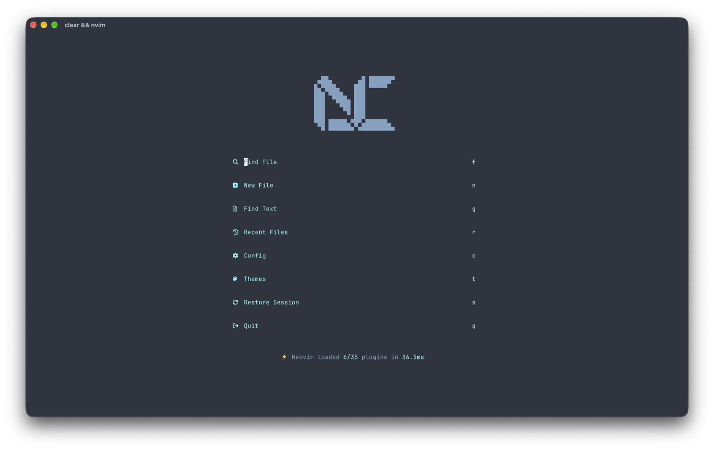
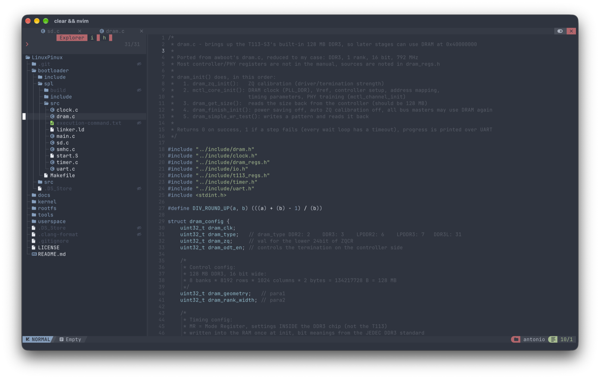
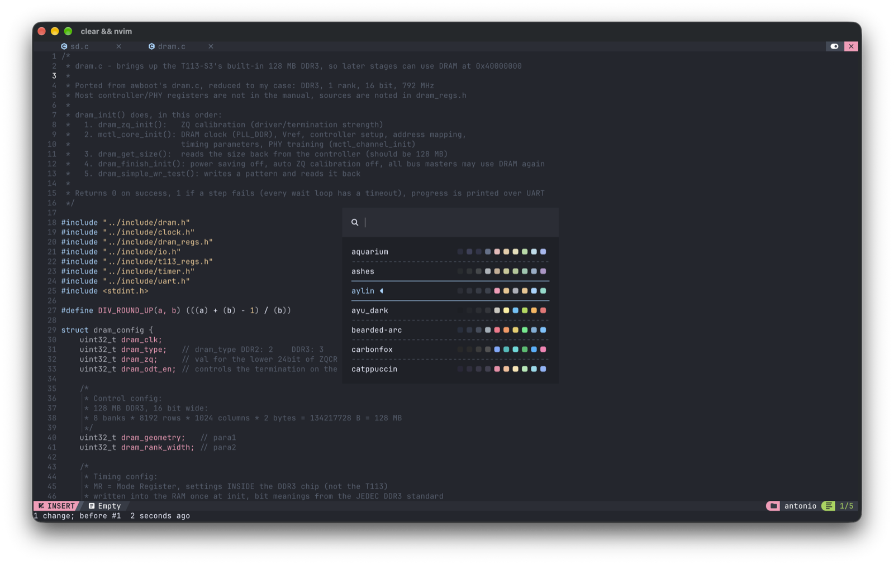

# nvim config

NvChad underneath, with a LazyVim-style layer on top. NvChad does the looks
(themes, statusline, tabs, theme switcher); LazyVim's plugins and keymaps
do the workflow.



| explorer | theme switcher |
|---|---|
|  |  |

## Install

```sh
git clone https://github.com/DSAntonio08/nvim_config.git ~/.config/nvim
~/.config/nvim/install.sh
```

Works on macOS (Homebrew), Debian/Ubuntu, Fedora and Arch. It installs
neovim (>= 0.11), ripgrep, fd, lazygit, node, python, clangd/clang-format
and a Nerd Font, then the plugins and any missing language servers/formatters
(through Mason). Safe to run again.

```
~/.config/nvim/
├── init.lua              entry point, loads everything in order
├── install.sh            installs the outside tools (see above)
├── lazy-lock.json        pinned plugin versions (written by lazy.nvim)
└── lua/
    ├── chadrc.lua        the look: theme, transparency, statusline, picker style
    ├── options.lua       editor settings
    ├── mappings.lua      keymaps
    ├── autocmds.lua      autocommands (syncs Ghostty's bg/titlebar to the theme)
    ├── configs/
    │   ├── lazy.lua        lazy.nvim settings
    │   ├── lspconfig.lua   language servers: clangd, lua_ls, pyright, rust_analyzer, ts_ls
    │   └── conform.lua     formatters per language
    ├── plugins/          every file here is loaded by lazy.nvim
    │   ├── init.lua        LSP, formatter, LuaSnip, treesitter
    │   ├── lazyvim.lua     snacks, flash, trouble, which-key, gitsigns, persistence, grug-far ...
    │   └── platformio.lua  :PIO commands + auto compile_commands.json for clangd
    └── snippets/html.lua own snippets
```

## Startup order (`init.lua`)

1. set leader keys (`<Space>`, localleader `\`)
2. bootstrap lazy.nvim
3. load NvChad, then `lua/plugins/` (overrides NvChad where they overlap)
4. load the theme from the base46 cache
5. `options` → `autocmds` → `mappings`

## Notes

- Theme switcher: `<leader>th`, `<leader>uC` or `t` on the start screen.
  It saves the pick into `chadrc.lua`.
- After editing `chadrc.lua` outside nvim, rebuild the theme cache:
  `:lua require("base46").load_all_highlights()` (or save it inside nvim).
- Formatting is manual only: `Alt+Shift+F`, never on save.
- clangd is allowed to query PlatformIO toolchains (`--query-driver`) so it
  finds headers like `avr/*.h`.
- Backup of the earlier tokyonight/transparent setup: `~/Documents/nvChad_attempt1`

Based on the [NvChad starter](https://github.com/NvChad/starter).
